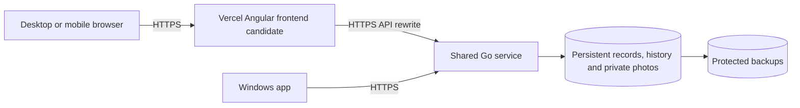

# Milestone and diagram coverage

M1 defines the domain, actors and scope. M2 v1.0 defines requirements and acceptance checks. M3 v1.0 defines how the system should behave. Use the PDFs as the source of truth and log discrepancies rather than silently changing the baseline.

## M1 scope and M2 trace

| M1 scope | Planned screens and service work | M2 functional requirements |
| --- | --- | --- |
| SC-01 Found item recording | Intake, optional photo and authorized correction of Open items | FR-001–002 |
| SC-02 Lost item reporting | My reports and authorized assisted visitor reporting/retrieval | FR-003–004 |
| SC-03 Directory | Signed-in search and public-field-only detail | FR-005–006, FR-017 |
| SC-04 Claim and verification | Submit, track, review evidence, decide, request review, reopen and record approved handover | FR-007–013, FR-028 |
| SC-05 Item status and custody | Transfer, contact attempts, holding period and permitted final disposition | FR-014–016, FR-018 |
| SC-06 Advisory matching | Compare permitted report/item attributes and show suggestions | FR-019–020 |
| SC-07 Login and roles | Labelled simulated credentials, server sessions and per-record permissions | FR-021–024 |
| SC-08 Activity history | Transactional append, admin chronological retrieval and repeat handling | FR-025–027 |

Use M2 Appendix A for the full crosswalk, including overlapping IDs. The [M2 register](m2-requirements.md) includes every requirement record, including interface, data, constraints and quality. Track future work and exclusions from M1 A4 and M2 §2.6 as scope decisions. Physical storage, identity checks and signed receipt handling stay manual. Police involvement uses manually recorded references. The project uses labelled test accounts and the M2 staff-assisted visitor workflow.

Finish the shared service and the core intake, report, search, claim and handover workflows first. Carry every committed M1–M3 requirement through implementation and acceptance. Schedule milestone-deferred features after the core, including SC-16 AI image matching. The core matching requirement is FR-019's attribute comparison.

## Diagram checks

PDF pages below are one-based. The original figures remain in the source milestone PDFs. Link the implemented Go modules, Angular screens, storage constraints and test evidence to the figure IDs as work lands.

| Figure | What must be reflected in the build | Check to record |
| --- | --- | --- |
| M1 Fig. 1, p.11 and M2 Fig. 1, p.15 | Role and external-system boundaries, one shared record across both desks, simulated identity | Walk each actor's permitted input/output. Verify no live SSO or police integration. Reconcile management arrows with M3 DFD-0 and deferred reporting scope. |
| M1 Fig. 2, p.12 | Item held at exactly one point. Reports and advisory matches, multiple claims, at most one approved claim and at most one disposition | Verify relationships on create, transfer, approval and release. Check storage-level uniqueness and link integrity. |
| M3 DFD-0 part 1, p.9 | 1.0 intake/correction and 3.0 directory/withdrawal use D1. 2.0 report/retrieval uses D2. 6.0 computes suggestions using D1/D2. | Verify authorized inputs, record outputs, public projection, and no history event or write for computing suggestions. |
| M3 DFD-0 part 2, p.10 | 4.0 claims and handover use D3 and D1. 5.0 handles holding points, status and contact events. | Verify current holding point, allowed custody transitions, blocked invalid disposition and actor history. |
| M3 DFD-0 part 3, p.11 | 7.0 controls identities and roles in D4. 8.0 manages D5 append-only activity and authorized queries. | Direct forbidden-request tests, session revocation, history access and mutation rollback. |
| M3 DFD-1, p.14, balancing table pp.14–15 | 4.1 submit/request review, 4.2 verify, 4.3 decide/reopen, 4.4 release. DF-42 carries checks internally. Parent endpoints and child flows balance. | Cross-check DF-05, DF-19–27, DF-38 variants and DF-42 against §2.3. Test unauthorized, duplicate, rejected/reopened, approved and handover paths. |
| M3 CD-1.1, p.30 | Domain entities and multiplicities, including disposition, claim, handover, history and holding-period setting | Map each concept to Go types or schema relationships. Verify valid transitions, reference integrity and multiplicities. |
| M3 CD-1.2, p.31 | Services, permission policy, replaceable sign-in and store responsibilities | Map service/store boundaries to code. Check authorized access before protected reads/writes and transaction ownership. |
| M3 CD-1.3, p.31 | Item/claim states, roles, verification checks, outcomes, actions and other enums | Assert permitted values across API, storage and UI. Verify no invented Reserved state and no claim cancellation or expiry. |
| M3 CD-1.4, p.32 | Distinct authorized identity, public/private views, photo, verification, handover, disposition and change-event data | Verify data schemas, allowlists, size limits, required receipt fields and privacy, including rejection of identity-document fields. |
| M3 SD-1a, p.37 | Authorize evidence access, read claim and item, then return evidence or an explicit failure. Store only results of manual checks. | Forbidden, missing, read error and success paths. Check no protected read on forbidden request and no state change in evidence review. |
| M3 SD-1b, p.38 | Authorize the decision, check existing submission before routing to approval/rejection | Test denial, lookup failure, exact retry, changed payload with reused key, and both branches. |
| M3 SD-1c, p.39 | Re-read eligibility in the critical section. Require Open/Submitted and both checks. Save conditionally, append history, read back and commit. | Competing approvals yield one winner and no losing write or history. Inject history, read-back and commit failures. Item remains Open until handover. |
| M3 SD-1d, p.40 | Re-read claim, require Submitted and a nonblank reason, append history and confirm after commit | Verify guards, atomic failure, complete read-back, reason-only rejection and same-key retry after lost response. |

## Figure and policy follow-up

Demo follow-up extends M2 DR-001, FR-005 and FR-006 with an optional generic public item name and a directory name filter. It affects M3 DFD-0 process 1.0 and process 3.0, flows DF-06, DF-13 and DF-14, and the FoundItem and public view in CD-1. Keep NFR-008's protection for photos, identifying details and contact information. Older records use the category as the display title. The name is supplied at intake and never derived from private descriptions.

Lost reports implement SC-02, FR-003/004/027, DR-002/005 and M3 process 2.0 with D2, DF-09 through DF-12 and DF-38. Visitor reports use the staff submitter's account. The report, optional private photo, submission key and append-only change entry commit together. Process 6.0 uses DF-34 through DF-37 to rank Open items in the same category by non-blank color, brand and building equality, with item ID as the tie-breaker. Suggestions use the public item projection and do not create a claim.

Claim submission covers the new-claim path of M3 4.1 (DF-19, DF-20.1, DF-25.1, DF-27.1/27.2 and DF-38.1) and M2 FR-007, FR-008, FR-024, FR-025 and FR-027. The server checks eligibility in the write transaction and uses partial unique indexes for active claims per claimant and approved claims per item. The claim, original response and history commit together. Claimants can retrieve only their own claims, including after an item leaves the directory.

Administrator evidence and decisions cover M2 FR-009 through FR-011 and M3 processes 4.2 and 4.3, DF-42 and SD-1a–d. Evidence access is read-only and requires the administrator role. The decision transaction verifies eligibility, records the outcome and manual checks, appends history, and confirms the saved result for retries. Approval keeps the item Open for handover. Withdrawal of an item with an approved claim is blocked while Q-13 is unresolved.

On-site review implements M1 A11, M2 FR-013 and FR-028, and M3 ClaimService.requestReview and ClaimService.reopen with the corresponding Claim operations. Process 4.1 records one outstanding request without changing the Rejected status (DF-19, DF-20.1, DF-27.1 and DF-38.1). Administrators see it in the claims list and evidence view (DF-27.3). Process 4.3 reopens an eligible claim with a reason (DF-21.2, DF-20.2, DF-25.1, DF-27.4/27.5 and DF-38.2). It keeps the prior rejection in history, clears the current checks and applies M3 R-15's restriction on another active claim by the same claimant for the item. Commands include the decision or reopening time they were issued against so an old form cannot change a later round of review. The review procedure remains subject to ST-03 validation.

Handover implements M1 A6 and BR-07, M2 FR-012 and DR-009, and M3 process 4.4 and ClaimService.completeHandover. Staff assigned to the current holding point can retrieve the approved claimant's name and item (DF-05, DF-24, DF-25.1 and DF-27.7). The server resolves the staff account from the session and the claimant account from the approved claim. One transaction records the paper receipt reference and signed acknowledgment (DF-23, DF-27.6), the Returned disposition (DF-26 and FoundItem.close), and the change event (DF-38.3). An exact retry returns the stored handover. The receipt itself stays at the holding point.

Custody implements M1 BR-04/05/08 and M2 FR-014 through FR-018 against M3 processes 3.0 and 5.0 and StatusService. A transfer records the previous and new holding points (DF-28, DF-31, DF-32 and DF-38). The handover queue uses the new holding point immediately. Non-return disposition records its date, basis and, for police, a reference (DF-29 and CON-004). The write checks Open status, no existing disposition and no approved claim (DF-32/33, M3 R-16); the history and receipt commit with the change. Contact attempts append to item history without changing custody or claim state. Withdrawal remains an administrator action for incorrect Open listings under FR-017.

For CON-005, startup loads `CAMPUS_HOLDING_PERIOD_DAYS` into the single stored setting when supplied (DF-30). The administrator sees received date plus that setting for Open items with no approved claim (DF-31). A fresh database has no default duration, and the date never changes item status. The implementation uses operator configuration for Q-11. The team still needs an agreed policy duration.

The item history view implements the found-item path of FR-026 and M3 process 8.0 (DF-40/41). It returns item and related claim events in timestamp order, with sequence and source as tie-breakers, and includes handover, disposition and contact details. Administrators can open final and withdrawn items by reference. Lost-report history retrieval remains open.

Intake correction implements FR-002 and M3 process 1.0 (DF-06/07/08 and DF-38). The administrator or original receiver assigned to the current holding point can update an Open record. The correction preserves the item identifier and receiving account, stores old and new values in history, and rejects a stale form. Custody uses the transfer operation.

M3 Q-14 names missing claim-status and release-details operations/actions in CD-1.2/1.3, the missing key-mismatch refusal in SD-1b, and the implicit read-back return in SD-1c. Keep these explicit in implementation tests and reconcile the editable figure sources before release. The original editable PlantUML/draw.io sources were not found in the workspace. Use the PDF panels as reference and check with the team for the source files.

Q-10 is the hosting/storage decision for Stage 0. The Q-11 loading mechanism uses the server setting described above. Q-12 and Q-13 remain open for approved claims. Q-01 through Q-09 retain the M2 Appendix C.2 status pending confirmed answers. Report evidence against each requirement and record any proposed change with the affected model and test.

The deployment sketch below is a proposal for Stage 0 and Stage 2. D1–D5 stay logical store boundaries in M3. They can share a physical database and transaction boundary.

